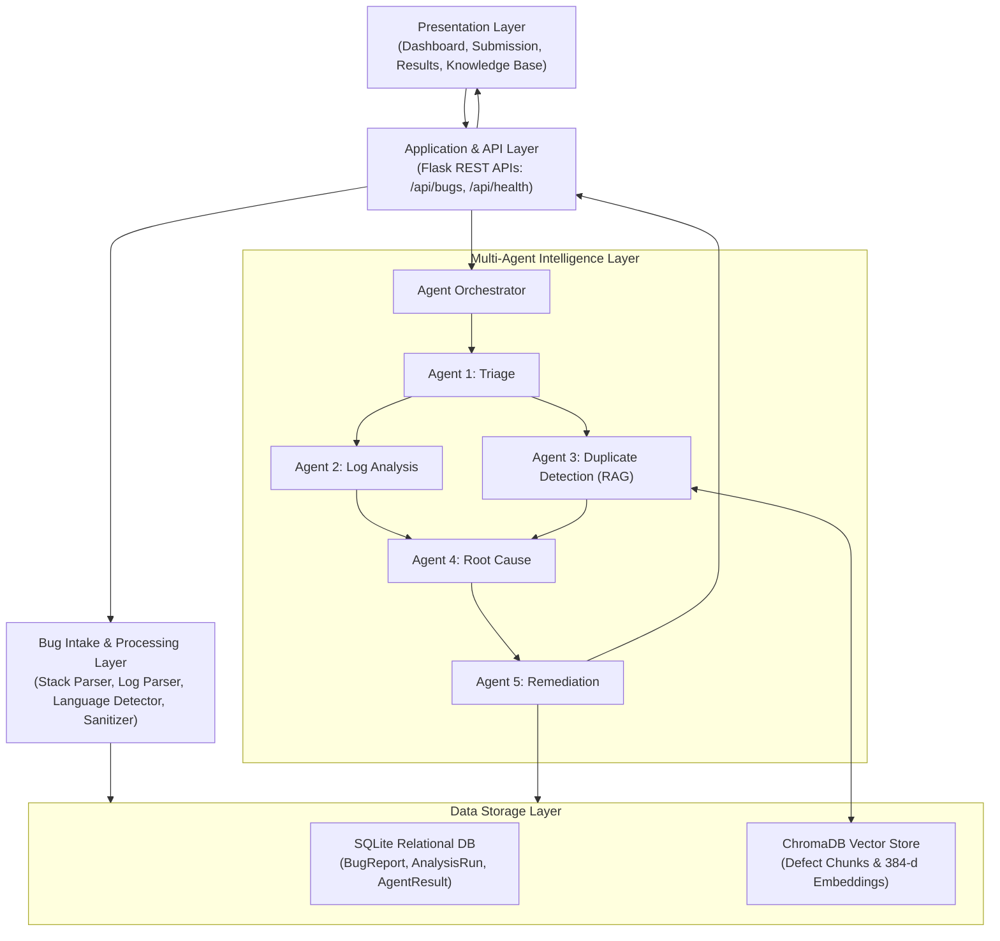

# Intelligent Bug Diagnosis Platform

An enterprise-grade platform that automates software defect diagnosis and fix recommendations by combining stack-trace parsing, multi-agent reasoning, and Retrieval-Augmented Generation (RAG). By grounding analysis in historical defect archives from Mozilla, Apache, and Eclipse, it helps engineering teams isolate root causes and resolve production incidents faster.

## Architecture



## Measured Accuracy

| Metric | Measured Accuracy (n=15) |
| :--- | :--- |
| **Severity Accuracy** | 60.0% |
| **Priority Accuracy** | 53.3% |
| **Exception Accuracy** | 80.0% |
| **Failure Point Accuracy** | 66.7% |

Numbers are honest; see docs/accuracy_report.md for the failure-case analysis.

## Quickstart

```bash
docker compose up -d
make seed
```
Open **http://localhost:5001** in your browser to submit bug reports and review diagnostic breakdowns.

## How Evaluation Works

The evaluation suite at `evaluation/run_eval.py` measures agent predictions against a 15-case ground-truth defect benchmark across diverse languages and noisy logs. A strict CI gate in GitHub Actions validates that triage and log analysis accuracy thresholds are maintained on every pull request.

## Tech Stack

- **Flask 3.1:** REST API routing, application factory, and web presentation layer.
- **SQLAlchemy 2.0:** SQLite relational database storing bugs, analysis runs, agent results, and feedback.
- **ChromaDB 1.5:** Local persistent vector database with cosine similarity ranking.
- **SentenceTransformers:** Dense 384-dimensional embeddings using `all-MiniLM-L6-v2`.
- **Multi-Agent Orchestrator:** Parallelized execution of Triage, Log Analysis, Duplicate Detection, Root Cause, and Remediation agents.

## Repo Layout

```
├── agents/          # Diagnostic AI agents and shared Pydantic schemas
├── archive/         # Archived legacy prototypes kept for provenance
├── backend/         # Intake processor, stack/log parsing, and Flask blueprints
├── config/          # Central configuration and logging setups
├── database/        # SQLAlchemy ORM models and repository CRUD layer
├── docs/            # Architecture specs, ADRs, runbook, and technical reports
├── frontend/        # Jinja2 templates and vanilla JavaScript dashboard UI
├── knowledge_base/  # Ingestion adapters, chunking, embeddings, and RAG retrieval
├── tests/           # Automated Pytest test suite covering agents and pipelines
└── uploads/         # Secure storage for uploaded bug reports and log traces
```

## Milestone Status

| Milestone | Completion | Status & Scope |
| :--- | :--- | :--- |
| **Milestone 1** | 88% | Foundation, schemas, chunking, RAG vector retrieval, and submission UI |
| **Milestone 2** | 90% | Triage & Log Analysis agents, Pydantic schemas, and evaluation harness |
| **Milestone 3** | Partial | Root Cause and Remediation agents (forward work for production diffing) |

## Limitations & Roadmap

- Knowledge base seeded from public samples not full Kaggle dumps.
- C++/Go stack traces support is basic.
- LLM calls fall back to rule-based mode offline.
- M3 remediation agent is forward work.

## License & Data

Seeded with public defect samples from Mozilla Bugzilla, Apache Jira, and Eclipse Bugzilla datasets. See [knowledge_base/datasets/README.md](file:///Users/sushilkumarpatel/Desktop/Intelligent-Bug-Diagnosis/knowledge_base/datasets/README.md) for provenance and licensing details.
