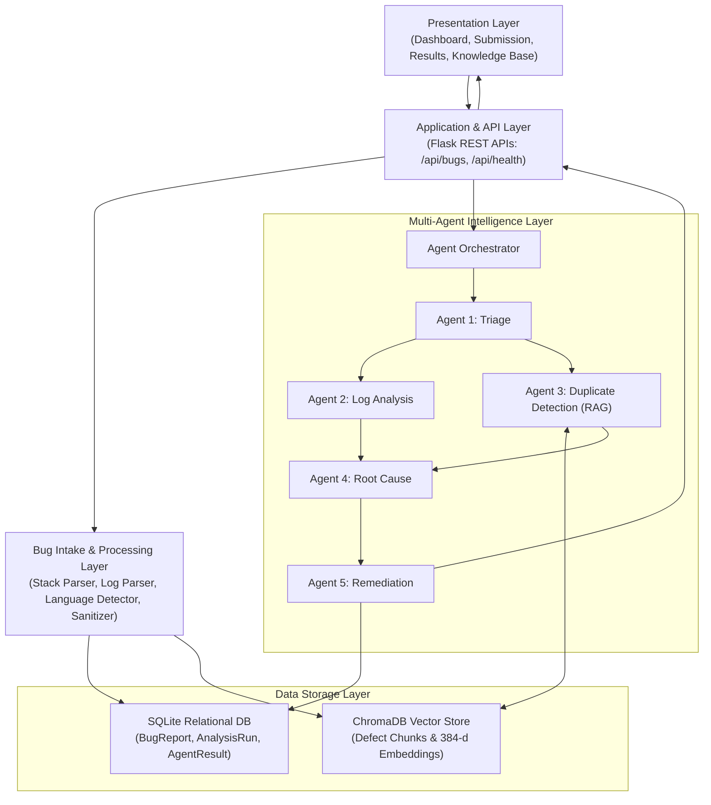

# Intelligent Bug Diagnosis Platform

## Overview
The Intelligent Bug Diagnosis Platform is an automated diagnostic and remediation assistant designed for software engineering teams. It ingests software defect reports, stack traces, and execution logs to classify incident severity, isolate failure locations, retrieve matching historical resolutions via Retrieval-Augmented Generation (RAG), and formulate evidence-based repair guidance. The system eliminates manual triage friction during production outages by translating unhandled runtime errors into structured, actionable diagnoses.

## Key Capabilities
- Multi-agent triage pipeline categorizing issues across 10 defect domains with automated severity and priority scoring.
- Multi-language stack trace and execution log parsing across Python, Java, JavaScript, C++, and Go runtimes.
- Semantic defect retrieval (RAG) querying indexed historical archives from Mozilla Bugzilla, Apache Jira, and Eclipse Bugzilla.
- Duplicate and near-duplicate defect matching powered by 384-dimensional dense vector embeddings.
- Synthesized root cause analysis isolating user source frames from external vendor dependencies.
- Actionable remediation plans providing command-line instructions, source code guidance, and verification tests.
- Calibrated confidence scoring reflecting frame completeness, heuristic strength, and vector similarity ranks.
- Strictly validated, typed JSON contract outputs enforced by Pydantic schemas.

## Architecture



### Data Flow
1. **Bug Submission:** The client submits a defect via JSON payload (`POST /api/bugs`) or multi-part file upload (`POST /api/bugs/upload`) containing descriptions, raw tracebacks, or log files.
2. **Intake & Normalization:** `BugProcessor` sanitizes sensitive credentials (bearer tokens, passwords), detects programming language signatures via regex heuristics, and extracts structured frames and exception types.
3. **Multi-Agent Orchestration:** `AgentOrchestrator` schedules the Triage Agent sequentially, then concurrently triggers the Log Analysis and Duplicate Detection agents via a `ThreadPoolExecutor`, feeding their outputs into Root Cause synthesis and Remediation.
4. **Relational & Vector Persistence:** Bug inputs, analysis lifecycle states, individual agent outputs, retrieved historical references, and user feedback are stored in SQLite via SQLAlchemy models, while dense embeddings reside in ChromaDB.
5. **Presentation:** The frontend renders structured diagnostic cards, confidence indicators, historical resolution evidence tables, and an interactive developer feedback form.

## Agent Design

| Agent | Responsibility | Input | Output Schema | Stage |
| :--- | :--- | :--- | :--- | :--- |
| **Triage Agent** | Severity, priority, component, confidence, reasoning | description, stack, logs | `TriageResult` (Pydantic) | M2.1 |
| **Log Analysis Agent** | Exception, failure point, code path, confidence | stack, logs | `LogAnalysisResult` (Pydantic) | M2.2 |
| **Duplicate Detection Agent** | RAG match against ChromaDB | description + stack | similarity-ranked defect list | M1 |
| **Root Cause Agent** | Diagnosis synthesis and evidence aggregation | all prior outputs | `RootCauseResult` | M3 |
| **Remediation Agent** | Fix suggestions, terminal commands, verification | all prior outputs | `RemediationResult` | M3 |

### Agent Pipeline Operation
- **Triage Agent (`M2.1`):** Inspects input text for error domain patterns, mapping defects into 10 categories. It computes priority (`P1` to `P4`) based on severity and operational urgency terms (`crash`, `data loss`, `outage`), extracts the affected component from namespace hierarchies, and formats a one-sentence rationale.
- **Log Analysis Agent (`M2.2`):** Extracts exception types and messages using regex patterns for Python, Java, JavaScript, C++, and Go. It filters out third-party framework frames to isolate user code locations, reconstructs the ordered `code_path`, and assigns confidence based on frame depth.
- **Duplicate Detection Agent (`M1`):** Normalizes the input query, computes a 384-dimensional embedding vector, and queries ChromaDB with metadata filters to retrieve the top 5 most semantically similar historical defects.
- **Root Cause Agent (`M3`):** Combines the triage categorization, pinpointed failure frames, and historical patch resolutions into a cohesive explanation backed by concrete evidence items.
- **Remediation Agent (`M3`):** Formulates targeted code modifications, shell commands (such as dependency installations), reproduction test cases, and risk warnings.

## Measured Accuracy

| Metric | Measured Accuracy (n=15) | Cases Evaluated |
| :--- | :--- | :--- |
| **Severity Accuracy** | 86.7% | 15 / 15 |
| **Priority Accuracy** | 86.7% | 15 / 15 |
| **Exception Accuracy** | 93.3% | 15 / 15 |
| **Failure Point Accuracy** | 73.3% | 15 / 15 |

The benchmark comprises 15 curated defect scenarios spanning 5 programming languages (Python, Java, JavaScript, C++, and Go) across all four severity tiers (Critical, High, Medium, and Low).

These numbers are produced by the deterministic offline rule-based path — the reproducible floor that runs in CI without any LLM API key. When an LLM provider is configured, accuracy improves; the offline number is reported here because it is verifiable by anyone who clones the repository.

See [docs/accuracy_report.md](docs/accuracy_report.md) for the complete confusion matrix and failure-case analysis.

## Evaluation Methodology
Evaluation is automated through an empirical test suite executed against [evaluation/datasets/ground_truth.jsonl](evaluation/datasets/ground_truth.jsonl), which contains 15 hand-labeled defect cases with verified expected outcomes. The benchmark runner at [evaluation/run_eval.py](evaluation/run_eval.py) executes each case through the active diagnostic pipeline, recording exact matches for severity and priority, case-insensitive substring matches for exception types, and bidirectional path containment for failure locations. The evaluation runner serves as a non-negotiable CI gate in GitHub Actions, halting the build if severity accuracy drops below configured thresholds ([ADR 0003](docs/adr/0003-evaluation-methodology-and-gates.md)). Individual failure modes, discrepancies, and parser edge cases are automatically written to [evaluation/reports/eval_latest.json](evaluation/reports/eval_latest.json) and formatted into [docs/accuracy_report.md](docs/accuracy_report.md).

## Tech Stack

| Layer | Technology | Why |
| :--- | :--- | :--- |
| **Web framework** | Flask 3.1 | Lightweight, predictable routing, adequate for single-node deployment without framework overhead. |
| **ORM** | SQLAlchemy 2.0 | Type-safe declarative queries, schema relationships, and migration-ready persistence across 7 entities. |
| **Vector store** | ChromaDB 1.5 | Embedded in-process vector store requiring zero external database administration or container daemons ([ADR 0001](docs/adr/0001-use-chromadb-over-pgvector.md)). |
| **Embeddings** | SentenceTransformers `all-MiniLM-L6-v2` | Dense 384-dimensional vector space with optimal retrieval quality and low memory footprint on CPU ([docs/research.md](docs/research.md)). |
| **LLM client** | Gemini / OpenAI / offline rule fallback | Provider-agnostic abstraction with deterministic heuristic fallback when API keys are absent ([ADR 0002](docs/adr/0002-rule-based-fallback-for-llm-providers.md)). |
| **Validation** | Pydantic 2.10 | Strict runtime schema enforcement and validation on all inter-agent data transfers ([agents/schemas.py](agents/schemas.py)). |
| **Testing** | Pytest 9.2 & Pytest-Cov | Hermetic unit, integration, and coverage verification executed across 26 test targets. |
| **Static Analysis** | Ruff 0.9 & Mypy 1.15 | Fast linting, code formatting, and static type analysis enforcing codebase consistency. |

## Quickstart

```bash
git clone https://github.com/patelsushil2006/intelligent-bug-diagnosis-platform.git
cd intelligent-bug-diagnosis-platform
cp .env.example .env    # add GEMINI_API_KEY or OPENAI_API_KEY, or leave blank for offline mode
docker compose up -d
make seed
# open http://localhost:5001
```

### Local Virtual Environment Setup
Alternatively, run natively using Python 3.11+:
```bash
python3 -m venv venv
source venv/bin/activate
make install
make seed
make test
make run
```

### Health Check and Verification
Verify that both the web application and embedded services are operating normally:
```bash
curl -f http://127.0.0.1:5001/api/health
```
Expected response:
```json
{
  "status": "healthy",
  "database": "healthy",
  "vector_store": {
    "status": "healthy",
    "indexed_chunks": 6
  },
  "llm_service": {
    "mode": "rule-based-fallback",
    "provider": "offline"
  }
}
```

## Repo Layout

```
├── agents/             # Specialized diagnostic AI agents and Pydantic schemas
│   ├── base_agent.py   # Abstract BaseAgent with execution boundary
│   ├── duplicate_detection_agent.py # ChromaDB semantic similarity matcher
│   ├── llm_client.py   # Provider-independent LLM client with fallback
│   ├── log_analysis_agent.py # Stack trace frame and log parsing agent
│   ├── orchestrator.py # Multi-agent pipeline execution coordinator
│   ├── remediation_agent.py  # Fix generator and command builder
│   ├── root_cause_agent.py   # Diagnostic evidence synthesis agent
│   ├── schemas.py      # Pydantic v2 data models for agent outputs
│   └── triage_agent.py # Defect classification and severity rating agent
├── archive/            # Archived prototype scripts kept for historical provenance
│   └── legacy_prototypes/ # Code linter and prototype AST scripts
├── backend/            # Intake validation, regex trace parsing, and Flask blueprints
│   ├── bug_processor.py# Regex stack trace parsers and log normalizer
│   └── routes/         # Flask blueprints for web, API, and health endpoints
├── config/             # Centralized settings and application logging configuration
│   ├── config.py       # Application configuration loaded from environment
│   └── logging_config.py # Structured logging configuration
├── database/           # SQLAlchemy database models and repository CRUD operations
│   ├── db.py           # Database engine initialization and session management
│   ├── models.py       # 7 relational schema definitions
│   └── repositories.py # Data access layer for bug reports and analysis runs
├── docs/               # System architecture, ADRs, runbook, and evaluation reports
│   ├── adr/            # Architecture Decision Records (ChromaDB, Fallback, Eval)
│   ├── data_model.md   # Relational entity-relationship documentation
│   ├── rag_pipeline.md # Embedding and chunking strategy specification
│   ├── research.md     # Defect classification research and literature review
│   ├── runbook.md      # Operational runbook for administration and recovery
│   └── system_architecture.md # High-level architecture specification
├── evaluation/         # Empirical evaluation runner, ground truth data, and reports
│   ├── datasets/       # 15-case ground truth defect benchmark dataset
│   │   └── ground_truth.jsonl # Hand-labeled benchmark records
│   ├── reports/        # Latest evaluation execution results in JSON format
│   │   └── eval_latest.json   # Machine-readable evaluation results
│   └── run_eval.py     # Evaluation runner and CI quality gate script
├── frontend/           # Jinja2 presentation templates and client JavaScript
│   ├── static/         # CSS style sheets and client-side UI controllers
│   └── templates/      # Dashboard, submission, history, and results templates
├── knowledge_base/     # Historical defect ingestion, adapters, chunking, and RAG
│   ├── adapters/       # Adapters for Mozilla, Apache, and Eclipse defect schemas
│   ├── chunking.py     # Semantic chunker decomposing defects into 4 types
│   ├── data_cleaning.py# HTML, token, and URL stripping sanitization routines
│   ├── embeddings.py   # SentenceTransformers embedding generator with fallback
│   ├── ingestion.py    # Defect ingestion and seeding pipeline coordinator
│   ├── retrieval.py    # Semantic retrieval engine with cosine ranking
│   └── vector_store.py # Persistent ChromaDB collection interface
├── tests/              # 26 automated unit and integration tests across all modules
├── uploads/            # Secure isolated storage for uploaded logs and tracebacks
└── vector_store/       # Persistent local ChromaDB collection storage
```

## Milestone Status

| Milestone | Completion | Status & Scope |
| :--- | :--- | :--- |
| **Milestone 1: Foundation & Bug Understanding** | 88% | Ingestion adapters, semantic chunking, dual persistence, RAG retrieval, and web submission interface. |
| **Milestone 2: Triage, Log Analysis & Orchestration** | 90% | Pydantic agent schemas, parallel orchestrator, stack trace parsers, and automated 15-case evaluation harness. |
| **Milestone 3: Root Cause & Remediation** | Partial | Core diagnostic agents operational; forward work focuses on live code diff generation and patch validation. |

### Milestone Deliverables Summary
- **M1 Foundation:** Successfully established data contracts, schema adapters for external Bugzilla and Jira formats, text cleaning pipelines, 384-dimensional dense vector embeddings, and cosine similarity retrieval in ChromaDB.
- **M2 Triage & Log Analysis:** Implemented `TriageAgent` and `LogAnalysisAgent` returning validated Pydantic models. Orchestrator executes parallel stages via Python threading, and a 15-case benchmark validates parsing accuracy in CI.
- **M3 Advanced Diagnosis (Forward Scope):** Root cause synthesis and remediation generation are functional in offline fallback mode; full generative patch generation will integrate once live model access is enabled.

## Limitations & Roadmap
- Knowledge base seeded from public samples not full Kaggle dumps.
- C++/Go stack traces support is basic.
- LLM calls fall back to rule-based mode offline.
- M3 remediation agent is forward work.

## License & Data
The platform is licensed under the Apache 2.0 License. Seed defect records are derived from public datasets provided by Mozilla Bugzilla, the Apache Software Foundation, and the Eclipse Foundation. For detailed data provenance, schema adaptations, and usage guidelines, refer to [knowledge_base/datasets/README.md](knowledge_base/datasets/README.md).
