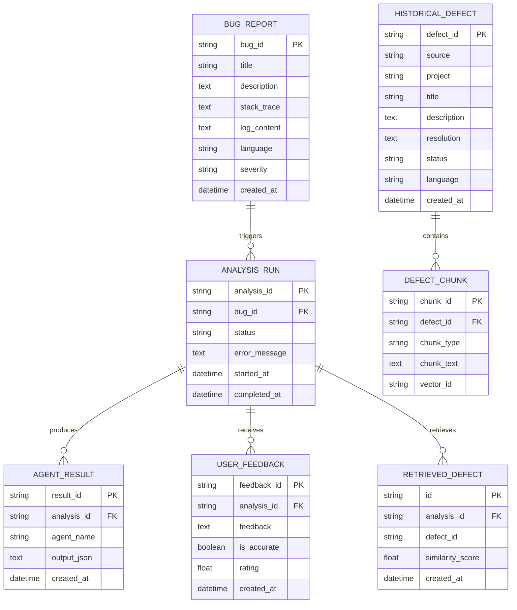

# Data Model & Storage Specifications

The platform uses two independent, synchronized data stores:
1. **SQLite (Relational Storage):** Manages structured entities, analysis runs, agent outputs, and user feedback.
2. **ChromaDB (Vector Storage):** Manages high-dimensional embeddings and metadata for semantic defect retrieval.

---

## 1. Relational Database Schema (SQLAlchemy / SQLite)



---

## 2. Vector Database Schema (ChromaDB)

- **Collection:** `historical_defects`
- **Embedding Dimensions:** 384 (`sentence-transformers/all-MiniLM-L6-v2`)
- **Distance Metric:** Cosine Distance ($D_{cosine} \in [0, 2]$)
- **Calculated Similarity Score:** $\text{Similarity} = \max(0.0, \min(1.0, 1.0 - \frac{D_{cosine}}{2.0}))$

### Chunk Metadata Structure:
```json
{
    "defect_id": "APACHE-LANG-1024",
    "source": "Apache",
    "project": "Commons-Lang",
    "chunk_type": "resolution",
    "language": "Java",
    "status": "RESOLVED",
    "title": "NullPointerException in StringUtils.join when array contains null elements"
}
```
