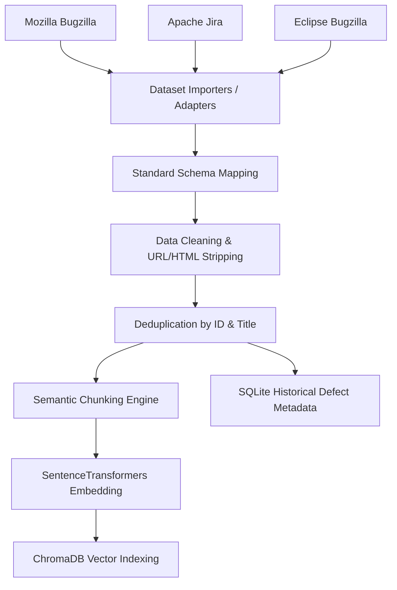

# RAG Pipeline & Semantic Retrieval

## 1. Ingestion Workflow

---

## 2. Chunking Strategy
Each ingested defect is partitioned into up to 4 discrete semantic chunks:
1. **`title_description`:** Synthesizes the defect title and problem description for high-level semantic matching.
2. **`stack_trace`:** Isolates raw exception tracebacks to match runtime failure signatures directly.
3. **`comment`:** Summarizes developer investigation notes and discussions leading up to the patch.
4. **`resolution`:** Stores the verified fix explanation, patch notes, or commit message.

---

## 3. Query & Retrieval Workflow
When a new bug is submitted:
1. The bug title, description, and stack trace are extracted and normalized.
2. The `EmbeddingEngine` generates a 384-dimensional dense vector using `all-MiniLM-L6-v2`.
3. The `ChromaVectorStore` performs a top-$K$ approximate nearest-neighbor query.
4. Chunks are aggregated by `defect_id`, and highest-scoring chunks are preserved.
5. The ranked defect records are injected into the context of the **Root Cause Agent** and **Remediation Agent**.

---

## 4. Evaluation Metrics
Retrieval performance is evaluated using:
- **Recall@K:** Fraction of relevant defects retrieved within top-$K$.
- **Precision@K:** Fraction of retrieved top-$K$ defects that are relevant.
- **Mean Reciprocal Rank (MRR):** $MRR = \frac{1}{\text{rank}_i}$ where $\text{rank}_i$ is the position of the first relevant historical defect.
