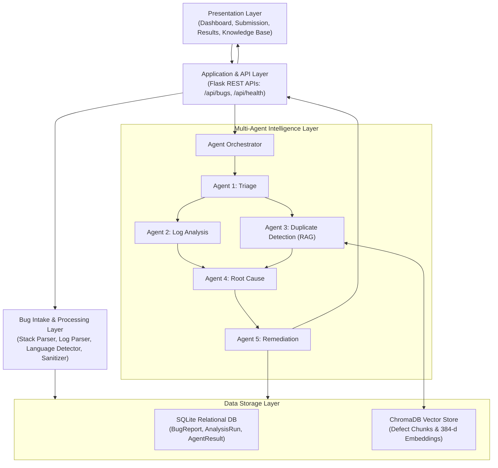

# System Architecture & Component Interaction

## 1. High-Level Architecture Overview

The platform implements a strictly layered modular architecture:

---

## 2. Layer Specifications

### Layer 1: Presentation Layer
- **Technologies:** HTML5, CSS3, JavaScript (Fetch API), JetBrains Mono + Plus Jakarta Sans typography.
- **Components:**
  - Overview Dashboard (`/`) with live system metrics.
  - Bug Submission Interface (`/submit`) with manual fields and file upload.
  - Diagnosis Results (`/results/<id>`) detailing root causes, evidence, agent tabs, and verified historical resolutions.
  - Bug History (`/history`) displaying status badges (`COMPLETED`, `PROCESSING`, `FAILED`).
  - Knowledge Base Explorer (`/knowledge-base`) for inspecting Mozilla, Apache, and Eclipse records.

### Layer 2: API and Application Layer
- **Technology:** Python 3.14 + Flask 3.1 Blueprints.
- **Endpoints:**
  - `POST /api/bugs`: Submit bug report as JSON.
  - `POST /api/bugs/upload`: Multi-part file upload with security validation.
  - `GET /api/bugs`: Paginated bug listing.
  - `GET /api/bugs/<bug_id>`: Fetch single bug report.
  - `POST /api/bugs/<bug_id>/analyze`: Trigger multi-agent pipeline.
  - `GET /api/bugs/<bug_id>/results`: Fetch compiled diagnosis report.
  - `POST /api/bugs/<bug_id>/feedback`: Record user validation feedback.
  - `GET /api/health`: Health status of database, ChromaDB, and agents.

### Layer 3: Bug Intake and Processing Layer
- **Input Validation:** Required field checks, payload size bounds (16 MB maximum).
- **Parsers:** Regex-powered stack trace parsers extracting exception types, file paths, line numbers, and function names for Python, Java, and JavaScript.
- **Log Parser:** Counts error/warning levels and extracts critical log entries.
- **Language Detector:** Heuristic marker analyzer matching trace patterns (`Traceback`, `at java.`, `node:internal`).
- **Security Sanitizer:** Redacts Bearer tokens, API keys, passwords, and sanitizes filenames using `secure_filename`.

### Layer 4: Multi-Agent Intelligence Layer
- **Triage Agent:** Categorizes into 9 classes (`Syntax`, `Runtime`, `Dependency`, `Database`, `Memory`, `Performance`, `Configuration`, `Logic`, `Network`) and rates severity.
- **Log Analysis Agent:** Analyzes stack frames, isolating user code from framework dependencies.
- **Duplicate Detection Agent:** Queries ChromaDB vector store using RAG to find historical defects with similarity ranking.
- **Root Cause Agent:** Synthesizes triage, log frames, and historical resolutions into an evidence-based diagnosis with confidence ratings (`High`, `Medium`, `Low`).
- **Remediation Agent:** Generates actionable fixes, shell commands, verification steps, and risk warnings.
- **Provider-Independent LLM Engine:** Supports live LLM providers (Gemini, OpenAI) with a **deterministic offline rule-based fallback mode** ensuring 100% functionality without internet access or API keys.
